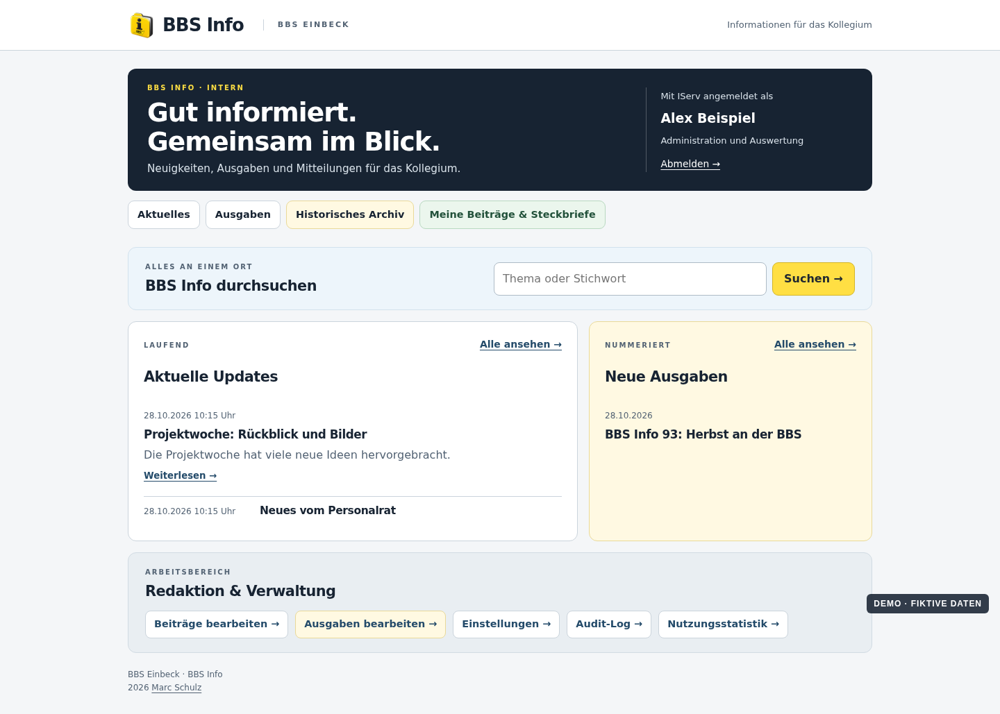

# BBS Info · BBS Einbeck

[Deutsch](README.md) · [Project site and demo screenshots](https://mail896.github.io/bbsinfo/)

**Version 1.4.3** · 2 November 2026 · Concept: Marc Schulz

BBS Info brings school news together for staff. It combines short updates, numbered issues and a searchable historical PDF archive in an access-controlled application. The source is public; articles, staff submissions, photos, archive PDFs, search logs and credentials are not.

## Features

- IServ sign-in with current staff-group checks and separate reader, editor and administrator roles.
- Ongoing updates with drafts, a rich-text editor, optimized images and editable text snippets.
- Staff-submitted articles and profile sheets with editorial review.
- Numbered issues assembled from selected articles, with embedded profile sheets, approved library photos, a web view and PDF download.
- Protected photo library: staff submit folders privately from a personal tab with upload progress and can resume interrupted uploads by selecting the same folder again with content matching; editors select originals for shared albums and choose a cover. During review, choosing an existing album hides the new album fields. Empty reviewed photo submissions are hidden from the personal list. Photo details place comments before compact editor-only correction controls. Visible album previews receive priority; approved previews use a private 24-hour browser cache before access is checked again. Uploaded photo filenames preserve Unicode characters. Year navigation, paginated albums, search for approved albums, previews, named comments, album ZIPs with an attribution manifest and audited access are included.
- A 30-day trash for updates, issues, private articles and profile sheets; editors can permanently delete issues without started mail delivery after extra confirmation and immediately release their number. Issues with started mail delivery remain protected.
- Editors can move pending submissions and unlinked adopted profile sheets directly to the trash and review all staff submissions there; personal trash views show only the owner's own pending submissions.
- Search across current content, approved photo albums and the protected historical PDF archive, including OCR-derived text.
- “My BBS Info” groups personal articles, profile sheets and photos with settings and trash. The appearance for this browser can be set to light, dark or system mode. Settings let staff opt in to updates and approved photo albums separately, with one immediate, daily or weekly cadence. Current IServ membership is checked before every message.
- Separate issue email with preview, editable template and an explicit gate for the staff-wide address.
- Editors open “Settings” from the right side of the main menu. Editorial settings appear there as a tab; audit log, usage statistics, search analysis, filters and CSV export remain administrator-only.
- A consistent desktop and mobile interface.

## Screenshots

The [project site](https://mail896.github.io/bbsinfo/) shows selected views. **All screenshots use fictional sample data.** They are rendered from the actual page templates, without a live IServ session or private content.



## Installation

[English installation guide](INSTALLATION.en.md) · [Deutsche Anleitung](INSTALLATION.md)

The public source uses neutral `school.example` addresses. A new installation requires Node.js 24, MariaDB, Python 3 with PDF/OCR packages, an IServ OIDC client and environment-specific domain, proxy and service configuration. Install dependencies and run the tests:

```sh
npm ci --ignore-scripts
npm test
```

The repository contains an example configuration, schema, migrations and tests. Keep actual credentials and private content outside Git. The mail and IServ addresses in this copy are placeholders.

## Repository and security

- `backend/`: OIDC, permissions, CMS, archive, email, audit and PDF processing.
- `design/web/`: shipped styles, scripts and folder artwork with fictional portraits.
- `db/`: current schema and additive migrations.
- `tests/`: synthetic functional and security-boundary tests.
- `docs/`: static GitHub Pages with fictional screenshots.

Secrets, private IServ data, real content, backups and internal development history are **not** published. This public copy has its own Git history. A staff-wide mail recipient must remain blocked until both explicit release gates have been deliberately enabled for an installation.

[Security reports](SECURITY.md) · [MIT license](LICENSE)
