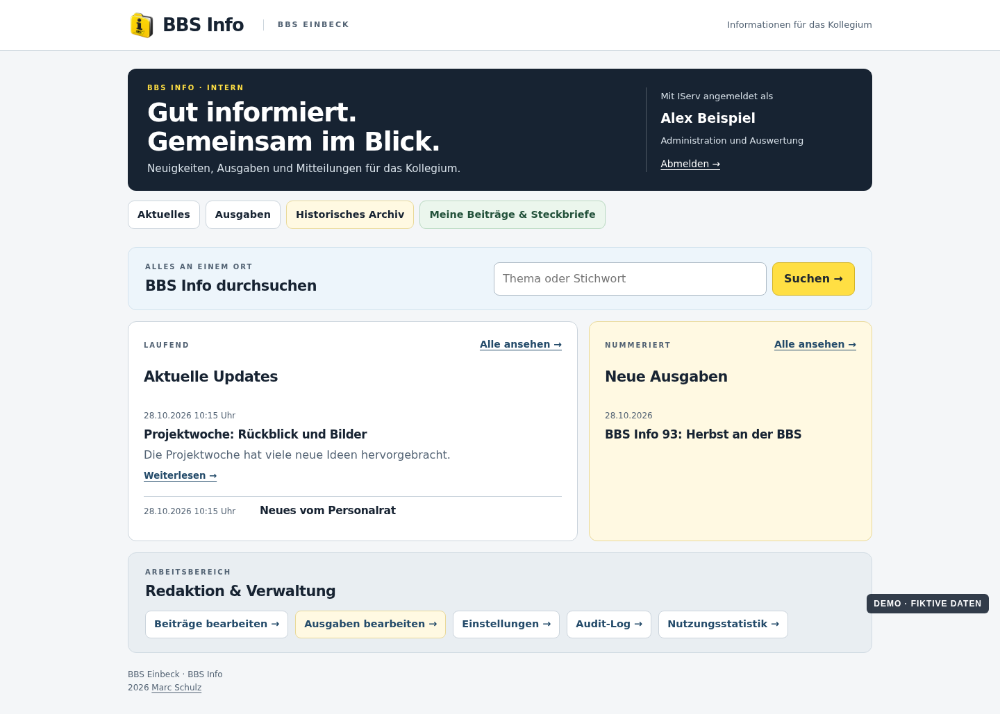

# BBS Info · BBS Einbeck

[Deutsch](README.md) · [Project site and demo screenshots](https://mail896.github.io/bbsinfo/)

**Version 1.1** · 29 October 2026 · Concept: Marc Schulz

BBS Info brings school news together for staff. It combines short updates, numbered issues and a searchable historical PDF archive in an access-controlled application. The source is public; articles, staff submissions, archive PDFs, search logs and credentials are not.

## Features

- IServ sign-in with current staff-group checks and separate reader, editor and administrator roles.
- Ongoing updates with drafts, a rich-text editor, optimized images and editable text snippets.
- Staff-submitted articles and profile sheets with editorial review.
- Numbered issues assembled from selected articles, with embedded profile sheets, a web view and PDF download.
- A 30-day trash for updates, issues, private articles and profile sheets; announced issues remain protected from deletion.
- Search across current content and the protected historical PDF archive, including OCR-derived text.
- Optional personal update email: immediate, daily, weekly or none, subject to a fresh IServ membership check before sending.
- Separate issue email with preview, editable template and an explicit gate for the staff-wide address.
- Administrator-only audit log, usage statistics, search analysis, filters and CSV export.
- A consistent desktop and mobile interface.

## Screenshots

The [project site](https://mail896.github.io/bbsinfo/) shows the main views. **All screenshots use fictional sample data.** They are rendered from the actual page templates, without a live IServ session or private content.



## Installation

[English installation guide](INSTALLATION.en.md) · [Deutsche Anleitung](INSTALLATION.md)

The public source uses neutral `school.example` addresses. A new installation requires Node.js 24, MariaDB, Python 3 with PDF/OCR packages, an IServ OIDC client and environment-specific domain, proxy and service configuration. Install dependencies and run the tests:

```sh
npm ci --ignore-scripts
npm test
```

The repository contains an example configuration, schema, migrations and tests. Keep actual credentials and private content outside Git. The mail and IServ addresses in this copy are placeholders.

## Repository and security

- `backend/`: OIDC, permissions, CMS, archive, email, audit and PDF processing.
- `design/web/`: shipped styles, scripts and folder artwork with fictional portraits.
- `db/`: current schema and additive migrations.
- `tests/`: synthetic functional and security-boundary tests.
- `docs/`: static GitHub Pages with fictional screenshots.

Secrets, private IServ data, real content, backups and internal development history are **not** published. This public copy has its own Git history. A staff-wide mail recipient must remain blocked until both explicit release gates have been deliberately enabled for an installation.

[Security reports](SECURITY.md) · [MIT license](LICENSE)
