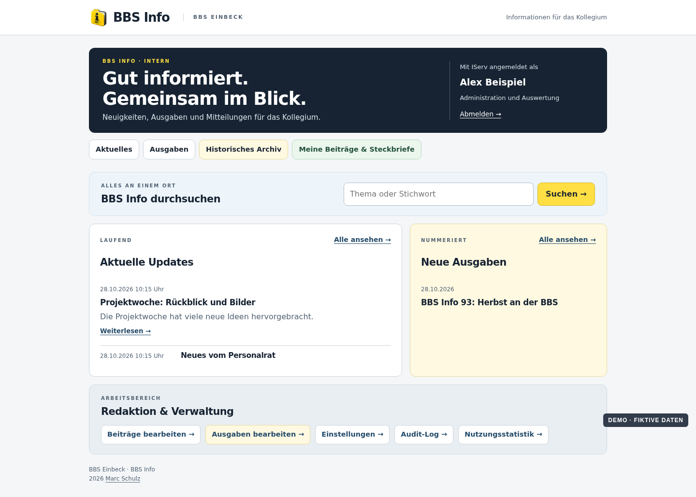

# BBS Info · BBS Einbeck

[English](README.en.md) · [Projektseite mit Demo-Screenshots](https://mail896.github.io/bbsinfo/)

**Version 1.4.3** · 2. November 2026 · Idee und Konzeption: Marc Schulz

BBS Info bündelt schulinterne Neuigkeiten für das Kollegium. Es verbindet kurze laufende Beiträge, nummerierte Ausgaben und ein historisches PDF-Archiv in einer geschützten Anwendung. Der Quellcode ist öffentlich; Beiträge, Steckbriefe, Fotos, Archiv-PDFs, Suchprotokolle und Zugangsdaten sind es nicht.

## Funktionen

- IServ-Anmeldung mit Kollegiumsprüfung, getrennten Rollen für Lesende, Redaktion und Administration.
- Laufende Beiträge mit Entwürfen, rich-text-Editor, Bildern und frei bearbeitbaren Textbausteinen.
- Eigene Beiträge und Steckbriefe des Kollegiums mit redaktioneller Übernahme.
- Nummerierte Ausgaben aus eigenen Texten und ausgewählten Beiträgen; eingebettete Steckbriefe, freigegebene Library-Bilder, Webansicht und PDF-Download.
- Geschützte Fotolibrary: Kolleginnen und Kollegen reichen Bilderordner im persönlichen Bereich mit Uploadfortschritt privat ein und können unterbrochene Uploads durch erneute Ordnerwahl mit Inhaltsabgleich fortsetzen; die Redaktion übernimmt ausgewählte Originale in gemeinsame Alben und wählt das Titelbild. Bei Ergänzungen zeigt die Sichtung nur die Angaben des vorhandenen Albums. Leere, gesichtete Fotoeinreichungen werden aus der persönlichen Liste ausgeblendet. Die Fotoansicht stellt Kommentare vor die kompakten, nur redaktionellen Korrekturwerkzeuge. Sichtbare Albumvorschauen werden bevorzugt angefordert; freigegebene Vorschaubilder nutzen 24 Stunden privaten Browsercache und werden danach bei erneuter Zugriffsprüfung validiert. Foto-Dateinamen mit Umlauten bleiben beim Upload korrekt. Jahresauswahl, paginierte Albumübersicht, Suche nach freigegebenen Alben, Vorschauen, namentliche Kommentare, Album-ZIP mit Herkunftsliste und auditierte Zugriffe sind enthalten.
- 30-Tage-Papierkorb für Updates, Ausgaben, private Beiträge und Steckbriefe; Ausgaben ohne begonnenen regulären Mailversand kann die Redaktion dort nach zusätzlicher Bestätigung endgültig löschen und ihre Nummer sofort freigeben. Ausgaben mit begonnenem regulärem Versand bleiben geschützt.
- Die Redaktion kann offene Einreichungen und unverknüpfte übernommene Steckbriefe direkt in den Papierkorb verschieben und dort Beiträge aller Konten prüfen; persönliche Papierkörbe zeigen nur eigene offene Einreichungen.
- Suche in neuen Inhalten und freigegebenen Fotoalben sowie im geschützten, teilweise per OCR erschlossenen historischen PDF-Archiv.
- „Mein BBS Info“ bündelt eigene Beiträge, Steckbriefe und Fotos sowie Einstellungen und Papierkorb. Dort ist die Darstellung für diesen Browser auf Hell, Dunkel oder System einstellbar. Benachrichtigungen für Aktuelles und freigegebene Fotoalben sind getrennt auswählbar, mit gemeinsamem Rhythmus sofort, täglich oder wöchentlich. Vor jedem Versand wird die aktuelle IServ-Gruppenzugehörigkeit geprüft.
- Getrennte Ausgaben-Mail mit Vorschau, bearbeitbarer Vorlage und ausdrücklicher Freigabe für einen Verteiler.
- „Settings“ steht für die Redaktion rechts im Hauptmenü. Dort sind redaktionelle Einstellungen als Tab erreichbar; Audit-Log, Nutzungsstatistik, Suchauswertung, Filter und CSV-Export bleiben ausschließlich für die Administration sichtbar.
- Einheitliche Oberfläche für Desktop und Mobilgeräte.

## Screenshots

Die [Projektseite](https://mail896.github.io/bbsinfo/) zeigt ausgewählte Ansichten. **Sämtliche Screenshots verwenden fiktive Demodaten.** Sie zeigen die echten HTML-Templates, aber keine Live-Inhalte und keine echte IServ-Sitzung.



## Installation

[Deutsche Anleitung](INSTALLATION.md) · [English installation guide](INSTALLATION.en.md)

Kurz: Node.js 24 und npm, MariaDB, Python 3 mit den für PDF/OCR benötigten Paketen sowie einen passenden IServ-OIDC-Client bereitstellen; dann `npm ci --ignore-scripts`, Schema, private Konfiguration, Reverse Proxy und Dienst einrichten. Ein frischer Installationspfad muss mit einer eigenen IServ-Umgebung und eigenen Domains angepasst werden. Der Public-Stand verwendet neutrale `school.example`-Adressen.

```sh
npm ci --ignore-scripts
npm test
```

Das Repository enthält Beispielkonfiguration, Schema, Migrationen und Tests. Reale Konfigurationen gehören mit restriktiven Rechten außerhalb des Repositorys. Die im Beispielcode eingetragenen Mail- und IServ-Adressen sind Platzhalter.

## Aufbau und Sicherheit

- `backend/`: OIDC, Rechte, CMS, Archiv, Mail, Audit und PDF-Verarbeitung.
- `design/web/`: ausgelieferte Styles, Skripte und gestaltete Mappe mit fiktiven Porträts.
- `db/`: aktuelles Schema und additive Migrationen.
- `tests/`: synthetische Tests für Fachlogik, Rechte und Sicherheitsgrenzen.
- `docs/`: statische GitHub Pages mit fiktiven Bildschirmansichten.

Secrets, private IServ-Daten, reale Inhalte, Serverbackups und die interne Entwicklungshistorie sind **nicht** Teil dieses öffentlichen Repositorys. Der öffentliche Stand hat eine eigene Git-Historie. Auch bei einer eigenen Installation darf die Mail an einen Gesamtverteiler erst nach expliziter Freigabe beider vorhandenen Sperren aktiviert werden.

[Sicherheitsmeldungen](SECURITY.md) · [MIT-Lizenz](LICENSE)
